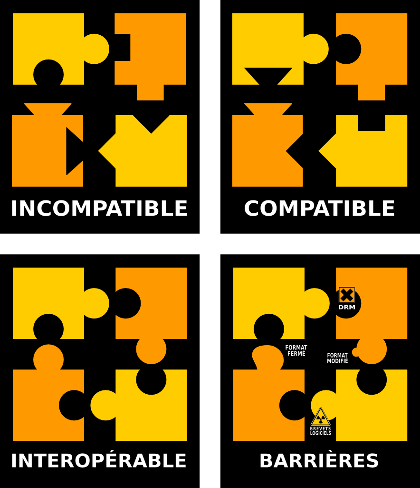

# HL7 : guide

## HL7 et l'interopérabilité en santé

L'interopérabilité permet à des équipements de communiquer entre eux et de s'échanger des données dans un langage commun, idéalement en suivant des standards. Dans le domaine de la santé, de nombreux équipements différents sont opérationnels dans les établissements de soin, de nature à la fois matérielle et logicielle. Nous pouvons citer par exemple les dossiers patients informatisés (DPI), les modalités d'imagerie et d'examens (IRM, Scanner, TEP...), le logiciel de suivi de bloc, la pharmacie, etc.

L'ensemble de ces équipements doit s'échanger de l'information afin de garder une cohérence du système d'informations de l'établissement de soin. Cela permet que l'ajout d'un rendez-vous pour un examen d'imagerie pour un patient A soit enregistré au sein de la modalité et que cette dernière enregistre directement les images de l'examen avec les données relatives au patient A. Cela évite une deuxième saisie des informations du patient A sur la modalité, donc des risques d'erreur, et permet de garder les informations à jour. En effet, si une information importante concernant le patient A est modifiée dans un équipement, cette mise à jour est aussi indiquée aux autres systèmes.

L'interopérabilité est donc primordiale en santé, et ne doit pas être confondue avec l'interconnexion.



## Le parcours patient et les messages de type ADT

Un des grands flux d'information au sein d'un établissement de santé est celui relatif aux informations administratives des patients et notamment leur parcours hospitalier.

En effet, tout patient dans un établissement de soin va suivre un parcours ponctué d'étapes et d'événements. Ainsi, dans le cas d'un séjour ambulatoire par exemple, un patient va être pré-admis pour une date d'hospitalisation, puis admis le jour J dans le service ambulatoire de l'établissement. Il sera ensuite transféré dans différentes zones (chambre, bloc, SSPI, retour en chambre), jusqu'à sa sortie définitive de l'établissement.

Ce parcours très simpifié (Admission, Transfert, Sortie) est suivi au sein de chaque système à travers un flux d'information ADT (Admission, Discharge, Transfert) via le standard HL7.

Ces messages HL7 de type ADT décrivent des événéments du parcours patient (une admission, un transfert...).

## Anatomie d'un message HL7

Un message HL7 est un fichier texte structuré en segment (un segment par ligne) permettant de transférer de l'information entre systèmes.

Voici un exemple de message HL7 :

```txt
MSH|^~\&|SIGEMS|SIGEMS|ENOVACOM|ENOVACOM|20151125123110.703+0100||ADT^A01^ADT_A01|54741010000051070000|P|2.5|||||FRA|8859/1
EVN||20151125123110||A01||20151125123007
PID|||68167^^^SIGEMS^PI||CURIE^MARIE^^^^^D~SLADOWSKA^MARIA^^^^^L||19300126|F|||3 AVENUE DES ALPAGAS^^ALPAGA CITY^^35000^^H~^^^^^^SA~^^^^^^O~^^MALAUNAY^^^^BR||^PRN^PH^^^^^^^^^0556030000~^PRN^CP^^^^^^^^^0600000000~^NET^Internet^NON|||M||1525253^^^SIGEMS^AN|||||MALAUNAY|||1||||N||VIDE
PD1||||||||||||N
ROL||UC|ODRP|111111111^CURIE^PIERRE^^^^^^ASIP-SANTE-PS&1.2.250.2.72.4.1.1&ISO^L^^^LLAMA~MARC00^MARC^BOB^^^^^^SIGEMS^L^^^EI|||||||116 BLD REPUBLIQUE^^ALPAGA CITY^^35000^^O
NK1|1|MR OTARIE^GEORGE|OTH^AUTRE||^PRN^CP^^^^^^^^^0600000000||C^Personne à contacter|20151125
PV1||I|CH01^213^213^330780000||PA68500^^^SIGEMS^AN^^20151027||10001112662^LEURS^HUGO^^^^^^ASIP-SANTE-PS&1.1.300.1.71.4.2.1&ISO^L^^^RPPS~331142000^VICTOR^HUGO^^^^^^ASIP-SANTE-PS&1.2.250.1.71.4.2.1&ISO^L^^^ADELI~VICT00^VICTOR^HUGO^^^^^^SIGEMS^L^^^EI|||181||||80|||||1525253^^^SIGEMS^AN^^20151125||03|Y||||||||||||||80||||||||20151125170000|||||||A
PV2|||||||SM|20151125170000|20151129180000|||||||||||||N
ZBE|1525253^SIGEMS|20151125170000||INSERT|N||Chirurgie 1^^^^^SIGEMS^UF^^^CHI1||HMS
ZFV|330780537^20151125000000|||||14 BIS BOULEVARD JOVIAL^^PARIS^^11111^FRA^DST|||80
```

Chaque segment commence par son identifiant de segment (MSH, EVN, PID, PD1, ROL, NK1, PV1, etc.). Ces segments sont ensuite découpés en champs, séparés ici par des symboles `|`. A l'intérieur de ces champs, des sous-champs peuvent délimités par des symboles `^`.
Chaque champ a une signification décrite dans le standard HL7.

Ainsi, le premier champ `MSH` correspond à l'en-tête du message (Message Header) et donne notamment des informations sur l'expéditeur (MSH|3 et MSH|4) du message et son destinataire (MSH|5 et MSH|6), le type de message (MSH|9), la version d'HL7 utilisée (MSH|12), etc.

Nous pouvons citer en segments d'intérêts, en plus de MSH :

* EVN, qui donne des informations sur l'événément ;
* PID, qui donne des informations sur l'identification patient (Patient Identification) ;
* PV1, qui donne des informations sur la visite du patient dans l'établissement.

## L'identification patient

L'identification patient est un facteur important dans le système d'information hospitalier. En effet, il faut pouvoir reconnaître un même patient à travers les différents équipements et logiciels au sein de l'établissement et - idéalement - entre établissements.

Au vu des problèmes d'homonymie et de probabilité d'avoir des dates de naissance identique, le trio nom/prénom/date de naissance n'est évidement pas l'identifiant du patient au sein du SIH.

Pour ce faire, on attribue au patient un ou plusieurs IPP (identifiant patient unique). Ces IPP sont générés par des logiciels garants de l'authentification patient et considérés comme identifiant de confiance par les autres logiciels.

Les IPP sont donc la référence d'identifiant patient sur lesquelles se basent l'ensemble des dispositifs communiquant avec le SIH.

Ces IPP sont composés d'un identifiant unique et de la référence de l'entité émettrice de cet identifiant. Par exemple : `1111^^^HMLIT^PI` indique que l'identifiant du patient est 1111 et il a été généré par Hopital Manager (module LIT).

## Message d'admission : ADT_A01

L'admission d'un patient est gérée avec un message HL7 de type ADT A01. Ce message comporte évidemment les identifiants du patient et des informations administratives le concernant (nom, prénom, etc).

En voici un exemple :

```text
MSH|^~\&|SIGEMS|SIGEMS|ENOVACOM|ENOVACOM|20151125123110.703+0100||ADT^A01^ADT_A01|54741010000051070000|P|2.5|||||FRA|8859/1
EVN||20151125123110||A01||20151125123007
PID|||68167^^^SIGEMS^PI||CURIE^MARIE^^^^^D~SLADOWSKA^MARIA^^^^^L||19300126|F|||3 AVENUE DES ALPAGAS^^ALPAGA CITY^^35000^^H~^^^^^^SA~^^^^^^O~^^MALAUNAY^^^^BR||^PRN^PH^^^^^^^^^0556030000~^PRN^CP^^^^^^^^^0600000000~^NET^Internet^NON|||M||1525253^^^SIGEMS^AN|||||MALAUNAY|||1||||N||VIDE
PD1||||||||||||N
ROL||UC|ODRP|111111111^CURIE^PIERRE^^^^^^ASIP-SANTE-PS&1.2.250.2.72.4.1.1&ISO^L^^^LLAMA~MARC00^MARC^BOB^^^^^^SIGEMS^L^^^EI|||||||116 BLD REPUBLIQUE^^ALPAGA CITY^^35000^^O
NK1|1|MR OTARIE^GEORGE|OTH^AUTRE||^PRN^CP^^^^^^^^^0600000000||C^Personne à contacter|20151125
PV1||I|CH01^213^213^330780000||PA68500^^^SIGEMS^AN^^20151027||10001112662^LEURS^HUGO^^^^^^ASIP-SANTE-PS&1.1.300.1.71.4.2.1&ISO^L^^^RPPS~331142000^VICTOR^HUGO^^^^^^ASIP-SANTE-PS&1.2.250.1.71.4.2.1&ISO^L^^^ADELI~VICT00^VICTOR^HUGO^^^^^^SIGEMS^L^^^EI|||181||||80|||||1525253^^^SIGEMS^AN^^20151125||03|Y||||||||||||||80||||||||20151125170000|||||||A
PV2|||||||SM|20151125170000|20151129180000|||||||||||||N
ZBE|1525253^SIGEMS|20151125170000||INSERT|N||Chirurgie 1^^^^^SIGEMS^UF^^^CHI1||HMS
ZFV|330780537^20151125000000|||||14 BIS BOULEVARD JOVIAL^^PARIS^^11111^FRA^DST|||80
```

Le champs EVN|2 indique la date de l'évenement. Il s'agit donc d'une admission du 25/11/2015 à 12h31 pour le patient Marie Curie (nom d'usage), Maria Sladowska de son nom de naissance, née le 26/01/1930 avec l'IPP 68167 délivré par SIGEMS en tant qu'identifiant patient.

On peut également y trouver son sexe, son adresse, numéro de téléphone et autres possibilités de contact.

Le type du message dans le header est bien A01, pour une admission.

## Message de transfert :

Un transfert de patient correspond à un changement de chambre ou de service d'un patient durant son parcours. Il comporte notamment l'ancienne localisation du patient et son nouvel emplacement.

Voici un exemple présentant le transfert du patient Patient112 PATIENT112 (nom de naissance), née le 13/10/1903, de la chambre 170 de la maternité à la chambre 174 du même service.

```text
MSH|^~\&|HMLIT|HMLIT|TELECOMSANTEPLI|TELECOMSANTEPLI|20140415154239||ADT^A02^ADT_A02|13444281|P|2.5|||||FRA|8859/1|FR||
EVN||20151126083028||||20151126083028|
PID|1||68167^^^SIGEMS^PI||PATIENT112^Patient112^^^MME^^L||19031013|F|||Updated Street^^HOMETOWN^^22000^100^H||06.35.35.35.22^PRN^PH^^^^^^^^^0635353522|||||354116574^^^HMLIT^AN|279101303514454||||||1|||||N|||||||||
PV1|1|I|MATER^174^174^220000301|||MATER^170^170^220000301|RVAL4^ROS ^Valerian^^^^^^HMLIT^^^^EI~221000300^ROS ^Valerian^^^^^^HMLIT^^^^ADELI|||165|||||||||314006574^^^HMLIT||03|Y||||||||||||||||||||||20140502040000|||||||A|
ZBE|12823281^HMLIT|20151126083028||INSERT|N||MATER^^^^^HMLIT^UF^^^MATER|MATER^^^^^HMLIT^UF^^^MATER|
ZFM|8||||
ROL|12823254^HMLIT|UP|AT|RVAL4^ROS ^Valerian^^^^^^HMLIT^^^^EI~221000000^ROS ^Valerian^^^^^^HMLIT^^^^ADELI|20151126083028|
```

## Message de sortie :

Ce message permet d'indiquer la sortie d'un patient de l'établissement.

## Ressources et outils

Pour vous aider, vous pouvez vous aider des ressources suivantes :

* [documentation officielle d'HL7 v2.5](http://www.hl7.org/implement/standards/product_brief.cfm?product_id=143) (le chapitre 3 correspond aux messages ADT), attention, un compte est nécessaire pour télécharger le standard
* [le site Caristix](https://hl7-definition.caristix.com/v2/) qui décrit de façon plus interactive les différents segments et messages HL7 ADT
* l'extension [HL7Tools](https://marketplace.visualstudio.com/items?itemName=RobHolme.hl7tools) pour [Visual Studio Code](https://code.visualstudio.com/) peut être utile, notamment son découpage du message en segments et champs
* la plateforme de tests d'interopérabilité de l'Agence du Numérique en Santé dispose [d'un générateur de message HL7](https://interop.esante.gouv.fr/PatientManager/home.seam) qui peut être utile pour vous générez des templates. **ATTENTION : ne jamais utiliser de DONNEES REELLES sur les plateformes de test.**
